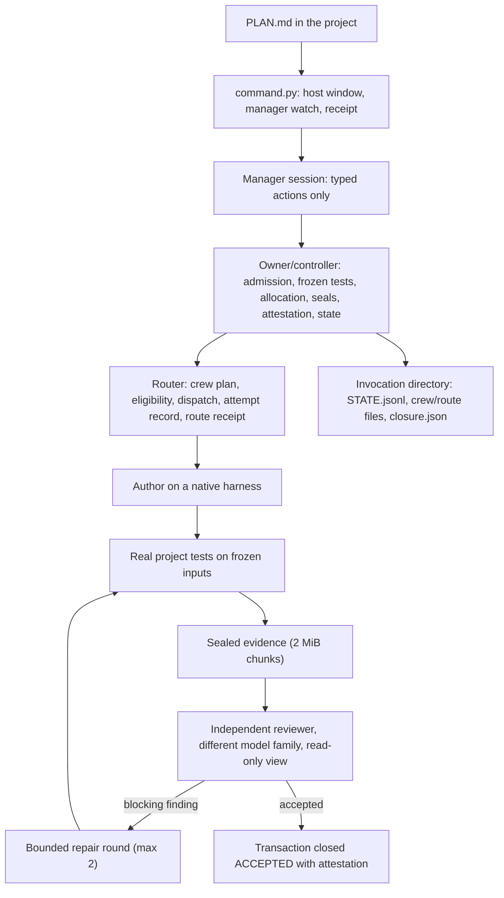

# Architecture

`/supervise` v2.8.2 is five cooperating parts. None of them is "the AI": the model sits inside the manager and inside each worker, and every decision that matters is enforced by code the model cannot bypass.

| Part | Responsibility | Trust position |
|---|---|---|
| **Transport** (`command.py`) | Public entry. Starts the manager session, enforces a finite host window (default 1800 s, at most 7200 s), detects manager error and stall, writes a transport receipt. | Untrusted input (the PLAN) in; receipt out. Adds no native allowance. |
| **Manager** (an OMP coding-agent session with the `supervise` extension) | Reads the PLAN, submits typed `supervise_continue` actions: `admit`, `author`, `repair`, `review`, `diagnose`, `reconcile`, `close`. | A model. It may not implement project files, call providers or the Router directly, or write control documents. |
| **Owner / controller** (Python; `ordinary_supervise.py`, `evidence.py`, `budget.py`, `migration.py`) | Validates and freezes admission, runs the frozen tests, allocates worker time within the checkpoint, seals evidence, verifies attestation, writes every state record, refuses anything that violates the admitted contract. | Trusted. The only writer of state. |
| **Router** (a staffing router, private) | Plans the crew (author, independent reviewer, fallback) from qualified benchmarks, production statistics and price; enforces eligibility and the author/reviewer family independence rule; dispatches one start to a native harness; records the attempt and the route receipt. | Trusted; its files are hash-pinned by the release publication and checked before dispatch. |
| **Native harnesses** (Claude Code, Codex, Pi, OpenCode) | Run a model with the user's own subscription in a governed sandbox: workspace-write rooted at the project, network denied by default, no ambient user configuration. Declared owned paths are registered, watched for effective-work evidence and snapshotted by the controller, with the frozen `tests/` observed separately; those byte checks cover the declared scopes and the tests, not every file in the workspace, so a change elsewhere relies on the project's tests and the independent review to be caught. Owned paths are not an operating-system write boundary. | Untrusted workers. Reviewers get a read-only, kernel-isolated evidence view. |

## Flow

## Admission

Admission builds a *correctable candidate* before anything is frozen: resolve project and source roots, validate the exact test argv and every acceptance selector against a real baseline run, validate any declared capability probe (SSH probes must be native, batch-mode, strict host key checking, finite connect timeout), then canonicalize, hash and freeze. A candidate that fails stays at version 0 (`PRECHECK_FAILED`, zero starts) and can be diagnosed and corrected. A frozen admission is immutable for the life of the transaction. Baseline policy is `all-green` by default or `nonregression` for scoped work with a completed red baseline.

## Crew planning

Before the first dispatch the Router plans the whole crew for the admitted class (for example `impl/deterministic/none/s/python` for the author and `review/judge/none/s/python` for the reviewer). Each candidate route carries qualification (benchmark level, native proof), execution statistics from the production ledger (attempts, completions, median seconds, platform failures) and pricing (prepaid subscription headroom counts as zero marginal cost). The author and the reviewer may not share a model family; an author with no eligible independent reviewer is excluded before anyone runs. The plan, its rationale and every exclusion with its reason are written to a sealed crew file.

## Evidence and attestation

Every start is reserved before execution (`route-N.json`: mission, transaction, class key, crew hash, publication hash, controller path, process identity) and verified after: the Router's attempt record and route receipt must carry the same attempt id, and the controller stamps the result. Evidence that crosses a role boundary is sealed and content-addressed in 2 MiB chunks; the reviewer's view is read-only and kernel-isolated (write, chmod, unlink fail; unrelated paths and credentials are invisible). A seal mismatch is a hard stop.

## State

One invocation directory per project + PLAN (its name is the SHA-256 of the two paths). Inside: the protected `pending.json`, `state.json` (status and version), the append-only `STATE.jsonl` (start / finish / outcome_closed), `decision.json`, `crew-N-<sha256>.json` and `route-N.json` per start, the native stream for each start, `last-review.json`, `accepted-review.json`, `closure.json`. Accounting is cumulative; re-invoking the same PLAN from the same project resumes the transaction. Renaming or copying the PLAN creates a new invocation and is prohibited by policy because it orphans the original accounting; the system does not link the two.

## Releases

Releases are immutable, read-only directories. `publication.json` pins the hash of every release file, every Router file the release depends on, the attempt-record schema and the runtime dependency modules. A reviewed-only installer publishes a release, backs up every pointer and Router file it replaces, and writes an installation record and a rollback record. The controller refuses to dispatch when the live Router bytes differ from the accepted publication. See the [owner and operator guide](owner-operator-guide.md) for the verification and rollback procedures.

---

*Part of the [`/supervise` public documentation](../../README.md), Apache License 2.0. Production documentation: https://nginx.leebasehome.com/docs/pages/supervision-overview.html*
